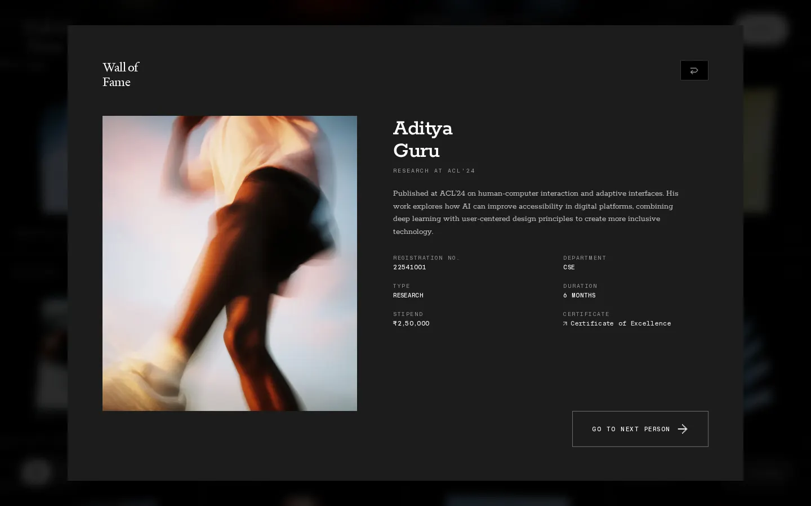
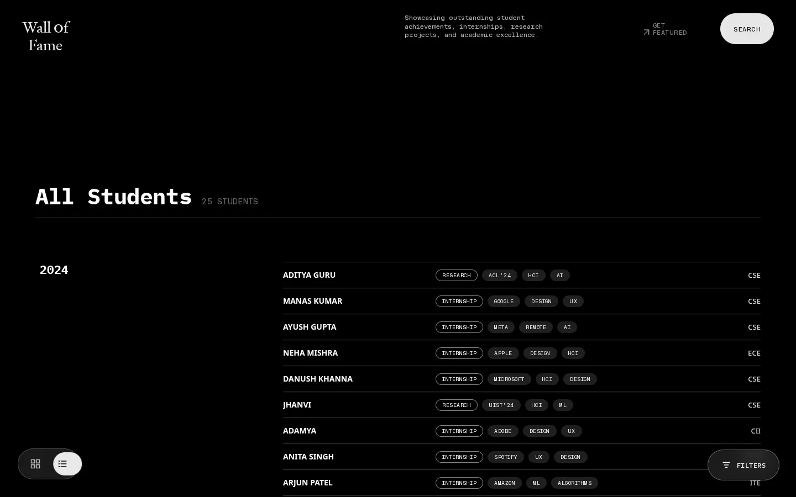
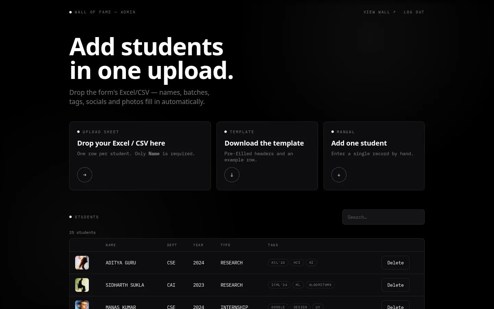
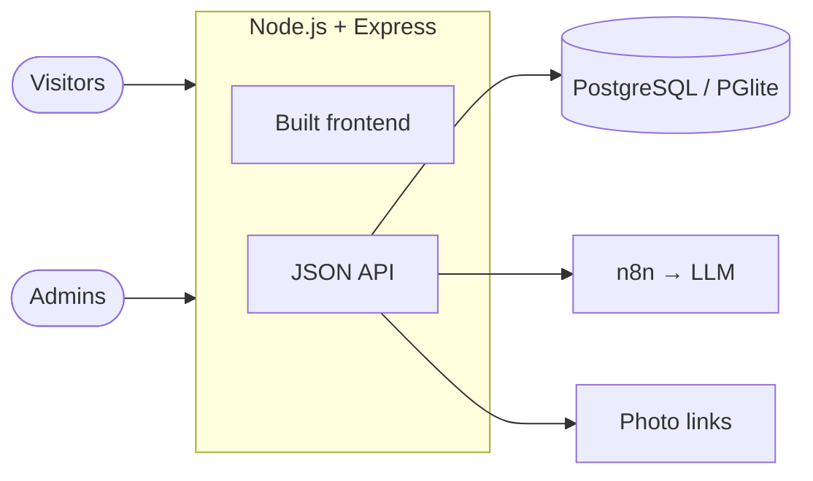

# Wall of Fame

An infinite, draggable wall of student achievements, built for **Manipal
University Jaipur** so students get noticed. Visitors browse the wall, open
profiles, filter and search. Staff add students by uploading the spreadsheet
their Google or Microsoft Form already produces. The server downloads the
photos, and an LLM writes a short bio and tags for each student.


| Profile | List view | Admin |
|---|---|---|
|  |  |  |

## Quick start

Requires **Node.js 20.12+** (22 recommended). No database server is needed:
locally the app uses PGlite, an in-process Postgres.

```bash
git clone https://github.com/AyushIsOn/wallOfFame.git && cd wallOfFame
npm install
cp .env.example .env
npm run dev:server   # terminal 1: API + database on :3000
npm run dev          # terminal 2: the site on http://localhost:5173
```

The admin is at http://localhost:5173/admin (password `change-me` from `.env`).
Drop [`docs/examples/import-example.csv`](docs/examples/import-example.csv) on
it to import three students. Full walkthrough:
[docs/getting-started.md](docs/getting-started.md).

## Features

- **Infinite WebGL wall** with a fisheye effect, colour hover glow and
  drag-to-pan. It draws only what's on screen and streams textures, so 5,000
  students use the same memory as 50.
- **Profiles** with bio, details, links and "next person" navigation; a
  **year-grouped list view**; **filters** (category, department, year) and **search**.
- **Spreadsheet import** (`.xlsx`, `.xls`, `.csv`): flexible column names,
  form-question headers, batch ranges like `2021-25`, Google Drive and OneDrive
  photo links, and safe re-imports that don't duplicate students or overwrite
  admin edits.
- **AI enrichment** through an [n8n workflow](n8n/README.md) (Groq or
  OpenRouter): About text → first-person bio + 2–3 tags, with a built-in
  fallback so imports always work.
- **Admin dashboard:** import, add, edit, delete, upload photos, generate tags.
- **One deployable service** for site, admin and API, on Render with PostgreSQL.

## How it works



The frontend is vanilla JavaScript with a custom Three.js renderer (no UI
framework). Every view renders from one store, `src/store.js`. The server is
Express 5 with plain SQL that runs on both PostgreSQL and PGlite; photos are
resized to WebP with sharp and stored in the database.
[Architecture](docs/architecture.md) explains the details and the reasons.

| Layer | Technology |
|---|---|
| Frontend | Vanilla JS, Three.js, GLSL, Vite |
| Backend | Node.js 22, Express 5 |
| Data | PostgreSQL (`pg`), PGlite locally |
| Media and import | sharp, SheetJS |
| AI | n8n + Groq / OpenRouter |
| Hosting | Render (`render.yaml`) |

## Documentation

| | |
|---|---|
| [Getting started](docs/getting-started.md) | Run it locally and import students |
| [Admin guide](docs/admin-guide.md) | For the staff who manage the wall |
| [Deployment](docs/deployment.md) | Render step by step, backups, checklist |
| [Configuration](docs/configuration.md) | Every environment variable and tunable |
| [API](docs/api.md) | Endpoints with real examples |
| [Architecture](docs/architecture.md) | How it works and why |
| [Data model](docs/data-model.md) | Fields, database, spreadsheet and import rules |
| [Code reference](docs/code-reference.md) | Every file and function |
| [Recipes](docs/recipes.md) | Common changes, step by step |
| [Troubleshooting](docs/troubleshooting.md) | Symptom → cause → fix |
| [Security](docs/security.md) · [Roadmap](docs/roadmap.md) | Controls and gaps · what's next |
| [HANDOVER](HANDOVER.md) · [CHANGELOG](CHANGELOG.md) · [CONTRIBUTING](CONTRIBUTING.md) | Taking over · history · how to change things |

The index of everything, including the academic report material, is
[docs/README.md](docs/README.md).

## Project layout

```text
index.html, admin.html   The two pages
src/                     Frontend: store, WebGL wall (gl/), UI modules (ui/), admin/
server/                  Express API, database, import, images, AI enrichment
public/                  Fonts, icons, sample photos and thumbnails
data.js                  25 sample students
n8n/                     AI enrichment workflow
docs/                    Documentation
```

## Scripts

| Command | Does |
|---|---|
| `npm run dev:server` | API + database on :3000 |
| `npm run dev` | Frontend with hot reload on :5173 (proxies `/api`) |
| `npm run build` | Production build to `dist/` |
| `npm start` | Serve `dist/` + API (what Render runs) |
| `npm run preview` | Preview the build on :4173 |
| `npm run thumbs` | Regenerate sample thumbnails |

## Deploying

Create a Render Postgres, create a Blueprint from this repo, set `DATABASE_URL`
and `ADMIN_PASSWORD`, and deploy. Step by step, including the free tier's
30-day database expiry: [docs/deployment.md](docs/deployment.md).

## Status

Feature-complete for a first launch and deployable to Render. Before going live
with real students, work through the
[production checklist](docs/deployment.md#production-checklist) and read the
[known limitations](docs/roadmap.md).

## Credits

Visual design inspired by [phantom.land](https://www.phantom.land). Built with
[Three.js](https://threejs.org), [Vite](https://vite.dev),
[Express](https://expressjs.com), [PGlite](https://pglite.dev),
[sharp](https://sharp.pixelplumbing.com), [SheetJS](https://sheetjs.com) and
[n8n](https://n8n.io).

The repository has no license file yet (`package.json` declares ISC); add one
before others reuse the code.
