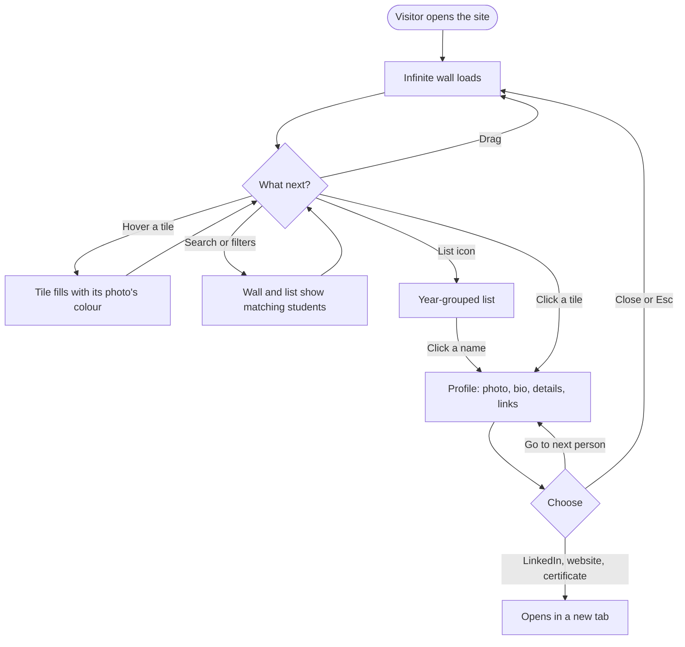
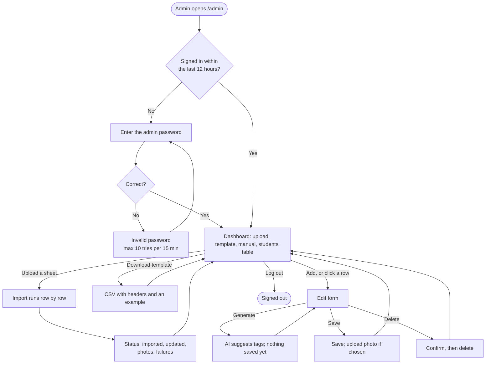
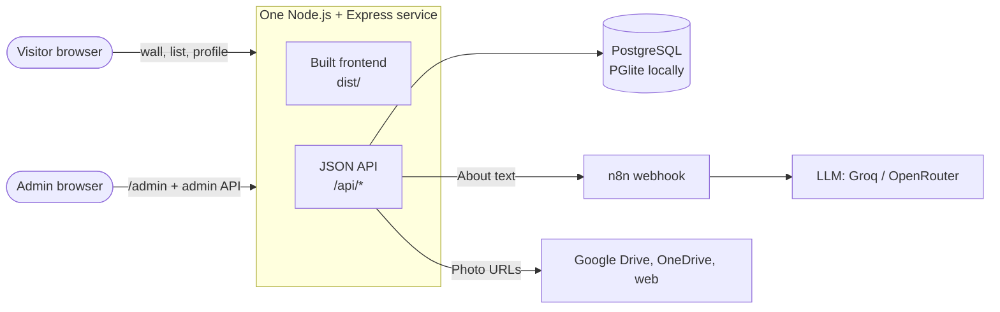
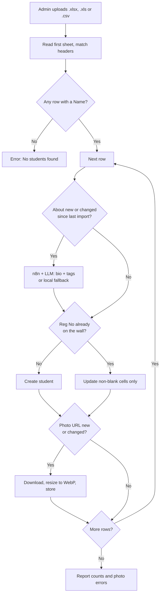
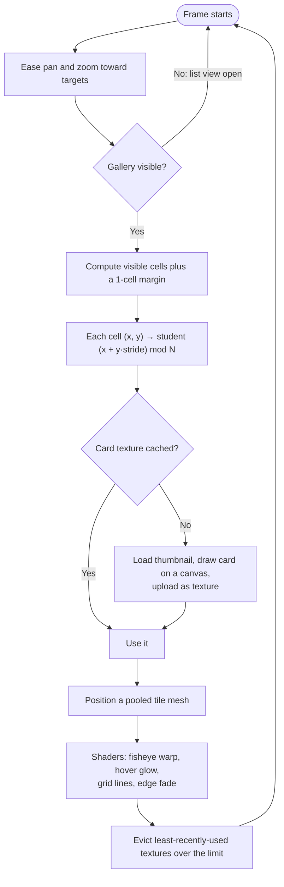
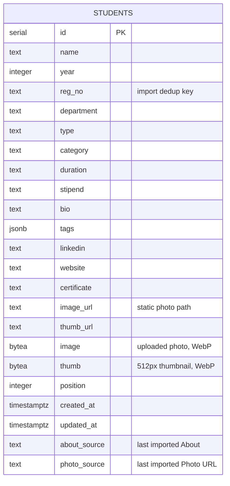
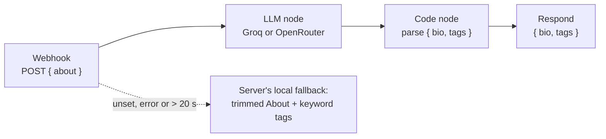
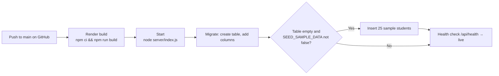
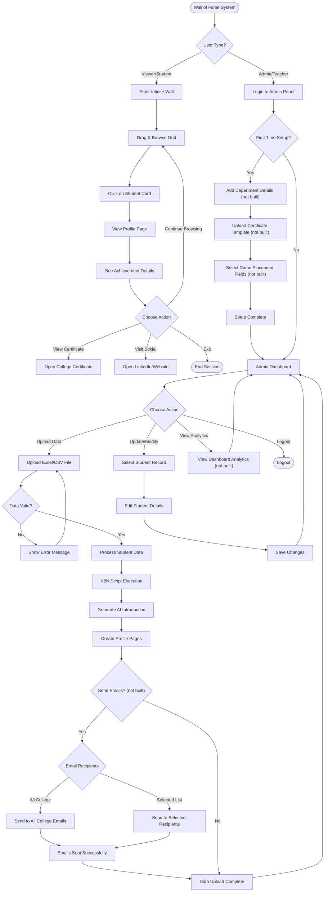

# Flowcharts

Diagrams for reports and presentations. **Part 1 shows the system as built**
(October 2026). **Part 2 is the original vision** from the project proposal,
with what was and wasn't built marked. GitHub renders these Mermaid diagrams
directly; to export images, paste them into [mermaid.live](https://mermaid.live).

- Part 1, as built: [Viewer flow](#1-viewer-flow) · [Admin flow](#2-admin-flow) · [System architecture](#3-system-architecture) · [Import pipeline](#4-import-pipeline) · [Rendering loop](#5-rendering-loop) · [Database](#6-database) · [AI workflow](#7-ai-workflow-n8n) · [Deployment](#8-deployment)
- Part 2: [Original vision](#part-2-original-vision)

---

## Part 1: As built

### 1. Viewer flow

### 2. Admin flow

### 3. System architecture

### 4. Import pipeline

### 5. Rendering loop

Runs every animation frame in the browser.

### 6. Database

### 7. AI workflow (n8n)

### 8. Deployment

---

## Part 2: Original vision

The proposal described a larger system. This table shows where each part
stands; [roadmap.md](../roadmap.md) has the remaining items.

| Vision item | Status |
|---|---|
| Infinite WebGL wall, profiles, socials | **Built** |
| Excel/CSV upload by teachers | **Built** (with header aliases, re-import rules, photo download) |
| AI-generated introductions via n8n | **Built** (bio + tags; local fallback) |
| Admin login and record editing | **Built** (single shared password) |
| Search and filters | **Built** |
| Certificate template upload and name placement | Not built (certificate is a URL field) |
| Email notifications to students or the college | Not built |
| First-time setup wizard (departments, certificate) | Not built |
| Analytics dashboard (views, clicks) | Not built |
| Separate tables for achievements, socials, departments | Not built (one `students` table) |
| Redis cache, S3/CDN image storage | Not built (photos in Postgres) |

The original "complete system" chart, kept for reference. The other original
charts (data flow, five-table schema, technology mind map, staging deployment,
email-sending n8n flow) are in the git history of `FLOWCHART.md`.

