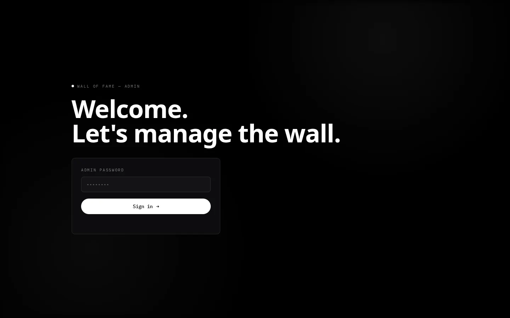
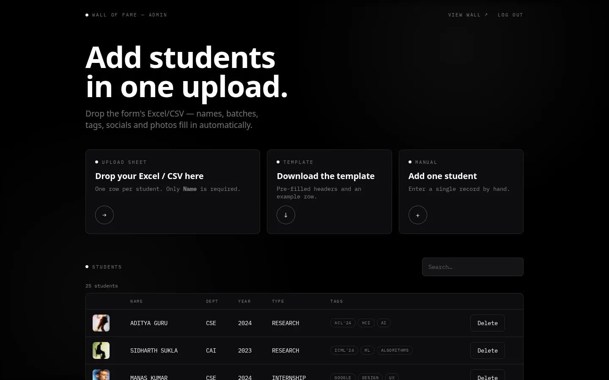
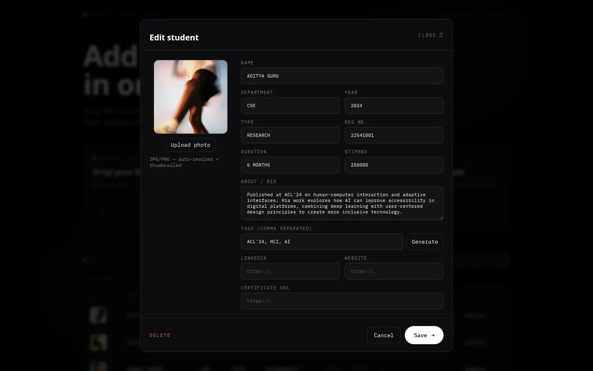

# Admin guide

For the teachers and staff who manage the wall. No programming needed.

- [Signing in](#signing-in)
- [The dashboard](#the-dashboard)
- [Import students from a sheet](#import-students-from-a-sheet)
- [Photos](#photos)
- [Updating a sheet you already imported](#updating-a-sheet-you-already-imported)
- [Add or edit one student](#add-or-edit-one-student)
- [What visitors can see](#what-visitors-can-see)
- [Common problems](#common-problems)

---

## Signing in

Open `/admin` on the site (for example `https://wall-of-fame.onrender.com/admin`)
and enter the admin password. The person who deployed the site set it as
`ADMIN_PASSWORD`.

- You stay signed in for 12 hours on that browser. **LOG OUT** (top right) signs
  you out right away; do that on shared computers.
- After 10 wrong passwords, sign-in is blocked from that network for up to 15
  minutes.

## The dashboard

| Area | What it does |
|---|---|
| **Upload sheet** | Drop an Excel/CSV file here (or click it) to add or update many students at once |
| **Template** | Downloads a CSV with the right column names and one example row |
| **Manual** | Add a single student by hand |
| **Students** table | Everyone on the wall. Click a row to edit it. **Search** filters by name, department, type or tag. |
| **VIEW WALL ↗** | Opens the public wall in a new tab |

Changes show on the wall the next time a visitor loads or refreshes the page.

---

## Import students from a sheet

This is the fastest way to add students: one row per student.

### 1. Prepare the sheet

Use the **Template** button, or your own sheet with a header row. Only **Name**
is required. Column names aren't case-sensitive, and several common names work
for each field:

| Column | Also accepted | Example | Notes |
|---|---|---|---|
| **Name** | Student Name, Full Name, Student | `RIYA DAS` | Required |
| Reg No | Registration No, Registration Number, Roll No, Roll Number | `22FE10CSE00101` | **Strongly recommended.** It lets you re-import the sheet without creating duplicates. |
| Year | Batch, Passing Year, Graduation Year | `2026` or `2022-2026` | A range like `2022-2026` or `2023-27` is saved as the passing year (2026 / 2027) |
| Department | Dept, Branch | `CSE` | |
| Type | Achievement Type | `INTERNSHIP` | Also used as the filter category, unless you add a Category column |
| Category | | `internship` | Optional |
| Duration | Period | `6 MONTHS` | |
| Stipend | Salary, Amount, Package | `250000` | Plain numbers show as ₹2,50,000; text like `Unpaid` shows as is |
| About | Bio, Description, Details, Achievement, Summary | A few sentences | Rewritten by AI into a short bio (see below) |
| Tags | Skills | `AI, ML, DESIGN` | Optional. Separate with commas. If empty, tags are generated from the About. |
| LinkedIn | LinkedIn URL | `https://www.linkedin.com/in/…` | |
| Website | Portfolio | `https://…` | |
| Certificate | Certificate URL, Certificate Link | `https://…` | |
| Photo URL | Photo, Image, Picture | `https://drive.google.com/file/d/…/view` | See [Photos](#photos) |

Other columns (Timestamp, Email, consent questions…) are ignored. A ready-made
example is in [`docs/examples/import-example.csv`](examples/import-example.csv).

### Using Google Forms or Microsoft Forms

You can import the form's responses directly:

- **Google Forms:** *Responses* → *Link to Sheets* → in the sheet, *File* →
  *Download* → *Microsoft Excel (.xlsx)* or *CSV*.
- **Microsoft Forms:** *Responses* → *Open in Excel* → download the file.

The column headers are the form's questions. Most fields need a header from the
table above, so either **title the questions with those names** ("Name",
"Reg No", "Batch", "Department", "About") or rename the header cells after
downloading. Link columns are more forgiving: a header that mentions *photo*,
*LinkedIn*, *certificate* or *website* works, such as "Upload your photo".

### 2. Upload it

Drag the file onto **Upload sheet**, or click the card and choose it. `.xlsx`,
`.xls` and `.csv` files up to 15 MB work; only the first sheet is read.

While it runs, the status line says *Importing students.xlsx…*. For each row,
the site:

1. **Rewrites the About** into a polished first-person bio of up to 256
   characters, and picks 2–3 tags. This uses the AI workflow if it's set up;
   otherwise the About is shortened and tags come from keywords.
2. **Saves the student**, or updates them if the Reg No already exists.
3. **Downloads the photo** from the Photo URL, if there is one, and makes a
   thumbnail.

Expect 1–3 seconds per row with AI, longer with photos. Keep the tab open until
it finishes. For hundreds of students, upload a few batches of about 100 rows.

### 3. Check the result

The status line summarises what happened, for example:

> Imported 3 new, updated 2, 4 photos saved. 1 photo failed: KABIR SINGH: photo
> link returned a web page, not an image (is the file shared publicly?)

Students whose photo failed are still added, with an initials placeholder. Fix
the link and re-import, or upload their photo by hand (below).

---

## Photos

**Best results:** a clear, roughly square photo of the student, at least
600 × 600 pixels. The site makes a square thumbnail for the wall (cropped from
the centre) and keeps a larger copy for the profile.

**From a sheet (Photo URL column):**

- Google Drive and OneDrive share links are converted to downloads
  automatically.
- The file must be shared as **"Anyone with the link"**. A private file gives
  the error *"link returned a web page, not an image (is the file shared
  publicly?)"*.
- **Google Forms file uploads** go into a folder in the form owner's Drive that
  is private by default. Open the folder in Drive → *Share* → *General access* →
  *Anyone with the link*, then import.
- **Microsoft Forms uploads** usually land in a school/work OneDrive or
  SharePoint that can't be made public. Those links fail; upload the photos by
  hand instead.

**By hand:** open the student → **Upload photo** → choose a JPG or PNG (up to
15 MB) → **Save**. The new photo shows right away.

**No photo:** the wall shows the student's initials in place of the photo, and
their name, year, tags and department still appear.

---

## Updating a sheet you already imported

Form responses keep growing, so you'll usually re-upload the whole sheet. That
is safe **as long as every row has a Reg No**:

| In the new sheet | What happens |
|---|---|
| A new Reg No | A new student is added |
| A Reg No that's already on the wall | That student is updated, not duplicated |
| A blank cell | The student's current value is kept. Blank cells never erase anything. |
| The same About as last time | The bio and tags are **kept**, including any edits you made in the admin |
| A changed About | A new bio and tags are generated |
| The same Photo URL as last time | The photo isn't downloaded again, and a photo you uploaded by hand is kept |
| A changed Photo URL | The new photo is downloaded |

Rows **without** a Reg No are added as new students every time you import, so
re-importing them creates duplicates. Delete duplicates from the table.

---

## Add or edit one student

Click **Manual** (or **+**) to add, or click a row in the table to edit.

| Field | Tip |
|---|---|
| Name | Required |
| Department, Type | Saved in capitals (e.g. `CSE`, `INTERNSHIP`) |
| Year | A number like `2025` |
| About / Bio | What shows on the profile. Unlike an import, what you type here is saved as written. |
| Tags | Comma separated. **Generate** suggests tags from the About / Bio text. Review them, then **Save**; nothing is saved until you do. |
| LinkedIn, Website, Certificate URL | Full links starting with `https://`. Leave empty if there isn't one; empty links are hidden on the profile. |
| Upload photo | Choose a file; it's uploaded when you click **Save** |

**Save** stores the student and closes the window. **DELETE** removes the
student after a confirmation; it can't be undone. **Cancel** or **CLOSE ✕**
discards changes.

---

## What visitors can see

Everything shown on a profile is public to anyone with the link: name, photo,
year, registration number, department, type, duration, stipend, bio, tags,
LinkedIn/website and certificate links. Anyone can also download the full list
through the site's API. Only add students who agreed to be featured, and leave
fields empty that they don't want shown.

### Removing the sample students

A new site starts with 25 sample students (stock photos, made-up names). Delete
them from the table one by one, or ask whoever runs the server to remove them in
one go ([recipes.md](recipes.md#remove-the-sample-students)).

---

## Common problems

| Problem | Fix |
|---|---|
| "Invalid password" | Check with whoever deployed the site. The password is the `ADMIN_PASSWORD` setting. |
| "Too many attempts. Try again later." | Wait up to 15 minutes. |
| "Session expired — sign in again." | Your 12 hours are up. Sign in again and redo the last change; it wasn't saved. |
| "No students found. The first row must be the headers…" | The sheet needs a header row with a **Name** column (or Student Name / Full Name) |
| "Could not read that file…" | Save it as `.xlsx` or `.csv` and try again |
| A photo failed | See [Photos](#photos): the file must be shared "Anyone with the link" |
| Duplicates after re-importing | Those rows had no Reg No. Add Reg Nos to the sheet and delete the duplicates. |
| The bio is just a shortened About | The AI workflow isn't connected (or it timed out), so the built-in fallback was used. Edit the bio by hand, or ask to set up [n8n](../n8n/README.md). |
| A change isn't on the wall | Refresh the wall page |

More: [troubleshooting.md](troubleshooting.md).
