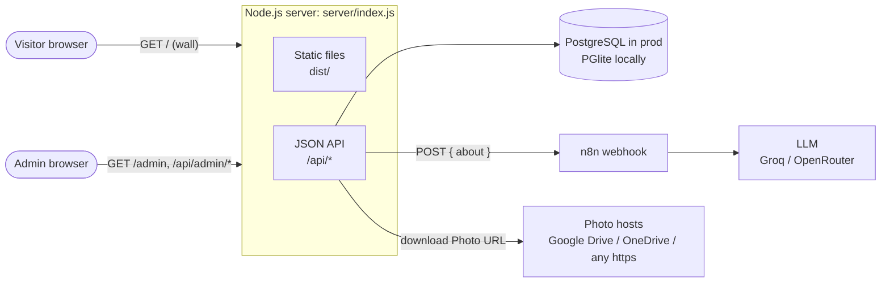
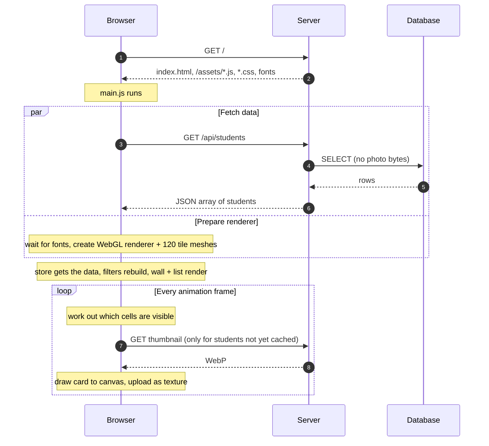
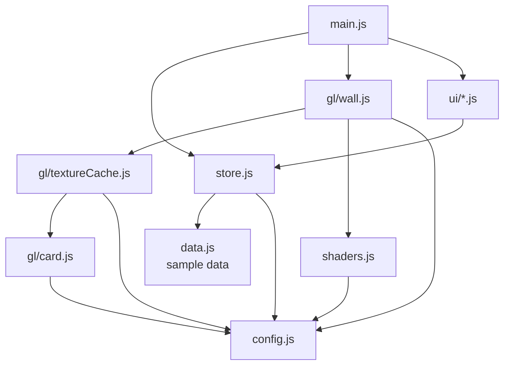
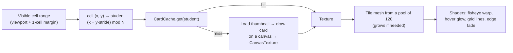
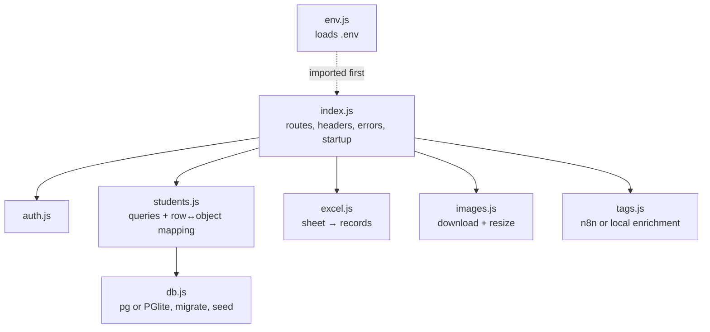
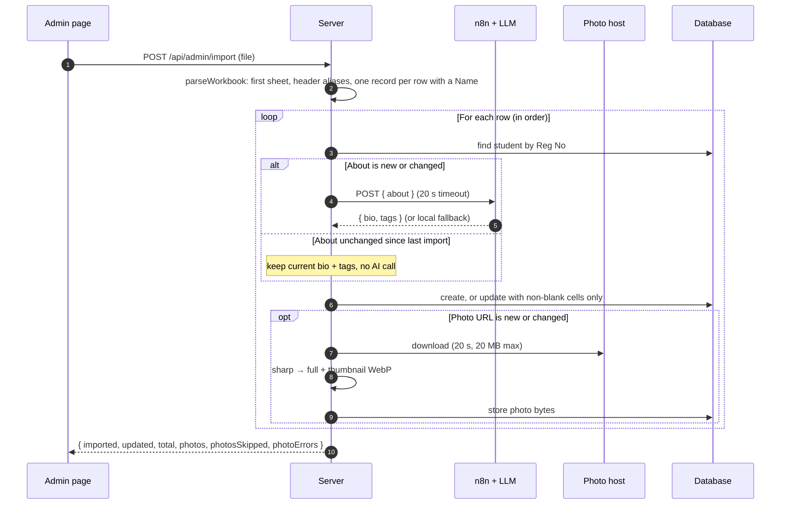

# Architecture

How Wall of Fame works, and why it is built this way. Read this before changing
the renderer, the data flow or the import pipeline. For a file-by-file
description of the code, see [code-reference.md](code-reference.md).

- [System overview](#system-overview)
- [Request flows](#request-flows)
- [Frontend](#frontend)
- [The WebGL wall](#the-webgl-wall)
- [Backend](#backend)
- [Import pipeline](#import-pipeline)
- [Design decisions](#design-decisions)
- [Glossary](#glossary)

---

## System overview

One Node.js process serves everything: the public wall, the admin dashboard and
the JSON API. Student data and photos live in PostgreSQL. In local development
the same SQL runs on PGlite, an in-process Postgres, so no database server is
needed.

| Part | Technology | Where |
|---|---|---|
| Wall page | Vanilla JS, Three.js (WebGL), custom GLSL | `index.html`, `src/` |
| Admin page | Vanilla JS | `admin.html`, `src/admin/` |
| Build | Vite (two HTML entry points) | `vite.config.js` |
| Server | Node.js ≥ 20.12, Express 5 | `server/` |
| Database | PostgreSQL (`pg`) / PGlite | `server/db.js` |
| Images | sharp (resize to WebP) | `server/images.js` |
| Spreadsheets | SheetJS (`xlsx`) | `server/excel.js` |
| AI enrichment | n8n workflow calling an LLM; local fallback | `server/tags.js`, `n8n/` |
| Hosting | Render (one web service + Postgres) | `render.yaml` |

There is no framework on either side, no build step for the server, and one
runtime dependency per job.

---

## Request flows

### Loading the wall

The request for students starts before font loading and WebGL setup, so they
overlap. Until the data arrives the wall stays black. It does not show
placeholder students or an empty-state message. If the request fails, a
production build says "Couldn't load students right now". A development build
(`npm run dev`) falls back to the sample data in `data.js` so you can work on
the frontend without the server.

### Opening a profile

A click on the wall is converted from screen pixels back to a grid cell (undoing
the fisheye warp), the cell is mapped to a student, and the profile overlay
opens with that student. The overlay's **Go to next person** steps through the
list the profile was opened from, which is the current filtered set. The
profile shows the full-size photo, not the thumbnail.

### Admin actions

The admin page logs in once (`POST /api/admin/login`) and keeps the returned
token in `localStorage`. Every admin call sends it as `Authorization: Bearer`.
See [Import pipeline](#import-pipeline) for the Excel flow and [api.md](api.md)
for each endpoint.

---

## Frontend

### Modules

- **`store.js` is the single source of truth.** It holds the students and the
  filter state (category, department, year, search) and notifies subscribers.
  Every view (wall, list, filters) renders from it, and nothing else fetches
  data. Changing where data comes from only touches this file.
- **`config.js`** holds every tunable the renderer and the interaction code
  share (cell size, fisheye strength, layout, cache sizes), so the shader and
  the click math cannot disagree.
- **UI modules** (`ui/filters.js`, `search.js`, `listView.js`, `viewToggle.js`,
  `profileOverlay.js`, `getFeatured.js`) are small `init…()` functions called
  once from `main.js`.

### Store states

| `store.status` | Meaning | What the user sees |
|---|---|---|
| `loading` | `/api/students` hasn't answered yet | Black wall; list says "Loading students…" |
| `ready` | Live data loaded | The students |
| `sample` | Dev build without the API, or `?seed=N` stress mode | The sample students from `data.js` |
| `error` | Production build and the API failed | "Couldn't load students right now. Please refresh the page." |

Filter options are recomputed from the loaded data each time, so a filter can
never offer a value with zero students. `CATEGORIES` in `config.js` only sets
the display order of the category pills.

---

## The WebGL wall

The wall is an infinite, draggable grid with a barrel ("fisheye") distortion. It
has to stay sharp, and it has to handle thousands of students on a phone. Two
ideas make that work.

### 1. Virtualisation: draw only what is visible

- Each frame, `Wall.updateVisibleTiles()` computes which grid cells are on
  screen, plus one extra ring so tiles don't pop in at the edges.
- Each cell maps to a student with `(x + y × stride) mod N`. The same cell
  always shows the same student, and the grid repeats infinitely. Drawing and
  click hit-testing share one function (`cellIndex`), so a click always opens
  the student drawn under the cursor.
- The **stride** is 3 for small walls (fewer than 64 students), which gives the
  diagonal pattern the design was tuned with. From 64 students it switches to
  17 or more, chosen to share no factor with N, so the rows on one screen never
  repeat each other. With stride 3 and 1,000 students, a 1440×900 screen showed
  only 23 different students, each about twice.
- A fixed pool of tile meshes is reused for whatever cells are visible. The
  mesh count depends on the screen size, not on the number of students.

### 2. Texture streaming: one card texture per visible student

- `gl/card.js` draws a student's **card** on a 2D canvas: the photo (centre
  60%), name and year (top band), tag pills and department (bottom band). The
  card's background is transparent so the hover glow can show through.
  Students without a usable photo get an initials placeholder instead.
- `gl/textureCache.js` keeps those cards as GPU textures in an LRU cache
  (72 desktop / 56 mobile). Textures not used in the current frame are disposed
  when the cache is over its limit. Textures on screen are never evicted.
- The wall loads the 512 px **thumbnail**, not the full photo.

Measured with the stress mode (`/?seed=N`, 1440×900, after panning 96 columns):

| Students | Tile meshes | Peak live textures | Errors |
|---|---|---|---|
| 1,000 | 120 | 72 | 0 |
| 5,000 | 120 | 72 | 0 |

GPU memory and network use depend on the viewport, not on N.

### Sharpness

An earlier version looked blurry. The causes and fixes are worth knowing before
touching the renderer:

| Cause | Fix |
|---|---|
| The fisheye was a full-screen post-process pass, which resampled the whole frame | The warp moved into the **vertex shader**; tiles render straight to the screen in one pass. Tile geometry is subdivided 12×12 so the curve is smooth. |
| Mipmaps blurred cards when drawn smaller than their texture | `generateMipmaps = false` with `LinearFilter` (`textureCache.js`) |
| Soft grid lines | Grid lines drawn in the fragment shader with `fwidth`, about 1.5 px at any zoom |

The sample photos in `public/` are deliberately motion-blurred art. Real photos
render sharp.

### Shaders (`src/shaders.js`)

- **Vertex:** world position → normalised screen position `u` →
  `s = u · (1 + K·|u|²)` with `K = WALL.distortionK` (0.08). The output is clip
  space directly, which is why the code uses a plain `THREE.Camera`.
- **Fragment:** `mix(glowColor × hover × 0.55, card.rgb, card.alpha)`, then grid
  lines, then a radial fade between radius 1.2 and 1.8 so the wall dissolves at
  the edges.
- **Hover glow colour:** each photo's dominant colour, computed once when the
  card is built (downscaled to 16×16, saturation boosted ×1.45, brightened).
- **Click math:** `Wall.cellCoordsAt()` applies the first-order inverse warp
  `d = 1 − K·r²` to go from screen pixels to a cell.

### Interaction

| Input | Effect |
|---|---|
| Drag (mouse or touch) | Pans. While dragging, the wall zooms out to 1.25 for context. |
| Click or tap under 200 ms, moving under 2 px | Opens that tile's profile (left button only) |
| Hover (desktop) | The tile fills with its photo's dominant colour |
| Resize | Renderer and aspect ratio update |

Pan and zoom ease toward their targets by 7.5% per frame. Input that starts on
an overlay (filters, search, view toggle, list, profile, header logo) does not
pan the wall. While the list view is open the gallery is `display: none`, and
the render loop skips GPU work.

---

## Backend

### Routes at a glance

| Route | Auth | Purpose |
|---|---|---|
| `GET /api/health` | – | Health check (Render uses it) |
| `GET /api/students` | – | All students (no photo bytes) |
| `GET /api/students/:id/image`, `/thumb` | – | Photo bytes from the database |
| `POST /api/admin/login` | – | Password → 12-hour token (rate-limited) |
| `POST/PUT/DELETE /api/admin/students[/:id]` | Bearer | Create / update / delete |
| `POST /api/admin/students/:id/image` | Bearer | Upload a photo (resized to WebP) |
| `POST /api/admin/students/:id/tags` | Bearer | Regenerate and save tags |
| `POST /api/admin/enrich` | Bearer | About text → `{ bio, tags }`, nothing saved |
| `POST /api/admin/import` | Bearer | Excel/CSV import |
| `GET /`, `/admin`, static files | – | The built frontend (`dist/`) |

Full details: [api.md](api.md).

### Layers

- **`db.js`** picks `pg` when `DATABASE_URL` is set and PGlite otherwise. Both
  expose the same `query(text, params)`, and all SQL is written once. On boot it
  runs `migrate()` (idempotent `CREATE TABLE IF NOT EXISTS` plus
  `ADD COLUMN IF NOT EXISTS`) and seeds the 25 sample students into an empty
  table, unless `SEED_SAMPLE_DATA=false`.
- **`students.js`** converts between database rows and the student object the
  frontend uses (see [data-model.md](data-model.md)). Listing never selects the
  photo bytes. It selects `has_image` / `has_thumb` booleans instead.
- **`index.js`** also sets security headers (CSP, `nosniff`, and frame
  protection for the admin page; see [security.md](security.md)) and caching
  (hashed assets and versioned photo URLs are cached for a year). It shuts down
  gracefully on `SIGTERM`.

### Photos

| Source | Stored as | URL in the API |
|---|---|---|
| Sample students | Files in `public/` (`img1.jpeg`, `thumbs/img1.webp`) | `/img1.jpeg`, `/thumbs/img1.webp` |
| Uploaded in the admin, or downloaded from a sheet's Photo URL | `bytea` columns: full (≤ 1200 px WebP) and thumbnail (512 px square WebP) | `/api/students/:id/image?v=…`, `/thumb?v=…` |

`?v=` is the row's `updated_at` timestamp. It changes whenever the student
changes, so a re-uploaded photo shows immediately and versioned URLs can be
cached for a year.

---

## Import pipeline

The admin's main job is uploading one sheet, usually the responses export of a
Google or Microsoft Form.

The rules that make re-imports safe are listed in
[data-model.md → Import rules](data-model.md#import-rules). In short:

- Rows with a **Reg No** update the existing student. Rows without one always
  create a new student.
- Blank cells never erase existing values.
- An unchanged About keeps the current bio and tags, including edits made in the
  admin, and skips the AI call. An unchanged Photo URL isn't downloaded again.

Rows are processed one at a time. That keeps per-sheet Reg No matching simple
and stays near free-tier LLM rate limits. In 2026 Groq's free tier allows about
30 requests a minute, and 1,000 a day for `llama-3.3-70b-versatile`; check
[Groq's rate-limit page](https://console.groq.com/docs/rate-limits) for current
numbers. When the limit is hit, the webhook fails and those rows get the local
fallback bio and tags. Large sheets are slow: plan on 1–3 seconds per row with
AI enabled.

---

## Design decisions

The main choices, what they cost, and when to revisit them.

| Decision | Why | Cost | Revisit when |
|---|---|---|---|
| **Vanilla JS + Three.js, no framework** | The wall is a custom renderer; a UI framework would add weight without helping it. The rest of the UI is a few small modules. | Manual DOM code, string templates (must escape) | The admin grows into many screens |
| **Single-pass, virtualised renderer** | Sharpness (no resampling) and bounded memory at any N | More math in the shader and the click code; both must stay in sync via `config.js` | – |
| **One canvas card per student, LRU-cached** | Simple; one texture per visible tile; text and photo composited once | Re-rasterises a card when it scrolls back in after eviction | Text needs to change per frame |
| **The store as the only data seam** | The whole backend was added by changing one frontend file | – | – |
| **One service for site + admin + API** | One deploy, no CORS, same-origin auth | Static files and API share one process | Traffic needs a CDN or separate scaling |
| **Postgres, PGlite locally** | Same SQL everywhere; zero-setup local dev | PGlite is single-process | – |
| **Photos as `bytea` in Postgres** | No second storage service to configure | Database size: the (soft, blurry) sample photos store as about 36 KB each, full + thumbnail; a sharp phone photo is larger, roughly 100–250 KB, so Render's 1 GB free database holds a few thousand students' photos. Photos are served through Node. | Thousands of students or heavy traffic: move to object storage (S3/R2) |
| **Stateless HMAC token, one shared password** | No user table or sessions; nothing to store | No per-person accounts or audit trail; rotating the password doesn't revoke existing tokens (rotate `TOKEN_SECRET` too) | More than a couple of admins |
| **AI via an n8n webhook, with a local fallback** | No LLM keys in the app; provider and prompt are editable in n8n; imports never fail because of AI | One more service to run | – |
| **Excel-first intake with header aliases** | Teachers already have form exports; no reformatting | Alias list must cover their headers | – |
| **Sequential import** | Simple Reg No matching; respects LLM rate limits | Slow for large sheets | Imports of hundreds of rows become routine (background job + progress) |

---

## Glossary

| Term | Meaning |
|---|---|
| **About** | The raw achievement text from the sheet or form |
| **Bio** | The text stored and shown on the profile. On import it is the AI-polished version of the About (≤ 256 characters). |
| **Enrichment** | Turning an About into a bio + 2–3 tags (n8n + LLM, or the local fallback) |
| **Cell** | A grid position `(x, y)` on the infinite wall |
| **Tile** | The mesh drawn in a cell |
| **Card** | The canvas texture drawn on a tile: photo, name, year, tags, department |
| **Thumbnail** | The 512 px square WebP the wall loads; the profile loads the full photo |
| **Stride** | The number in `x + y × stride` that maps cells to students |
| **Category** | Lowercased achievement type used by the filter (`internship`, `research`, `hackathon`…) |
| **Reg No** | Registration number, the key that makes re-imports update instead of duplicate |
