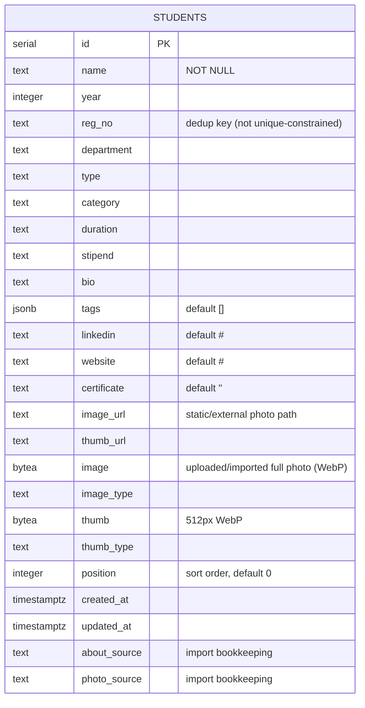

# Data model

Everything about a student's data: the object the frontend uses, the database
table, how rows map to objects, and the exact rules for turning a spreadsheet
row into a student. Code: `server/students.js`, `server/db.js`,
`server/excel.js`, `src/store.js`.

- [The student object](#the-student-object)
- [Database table](#database-table)
- [Reading: row → object](#reading-row--object)
- [Writing: object → row](#writing-object--row)
- [Spreadsheet → student](#spreadsheet--student)
- [Import rules](#import-rules)
- [Sample data](#sample-data)

---

## The student object

`GET /api/students` returns an array of these. The wall, list view, profile and
admin all use this exact shape. This one is the first row of
[`docs/examples/import-example.csv`](examples/import-example.csv) after a local
import:

```json
{
  "id": 26,
  "name": "RIYA DAS",
  "year": 2026,
  "regNo": "22FE10CSE00101",
  "department": "CSE",
  "type": "INTERNSHIP",
  "category": "internship",
  "duration": "2 MONTHS",
  "stipend": "80000",
  "bio": "Riya interned at Atlassian on the Jira mobile team, where she shipped offline sync for editing issues.",
  "tags": [],
  "socials": { "linkedin": "https://www.linkedin.com/in/example", "website": "#" },
  "certificate": "",
  "image": "/api/students/26/image?v=1793486612145",
  "thumbnail": "/api/students/26/thumb?v=1793486612145"
}
```

`tags` is empty because no n8n webhook was configured, and the local fallback
found no acronyms or known keywords in this About. With n8n, the LLM picks 2–3
tags and rewrites the bio.

| Field | Type | Notes | Shown on |
|---|---|---|---|
| `id` | integer | Database serial | – |
| `name` | string | Always present. Sheets usually have it uppercase; the profile title-cases it | Wall tile (top-left), list, profile |
| `year` | integer or `null` | Batch / passing year, 1950–2100 | Tile (top-right), list groups, year filter |
| `regNo` | string | Registration number; the import's dedup key | Profile |
| `department` | string | Uppercased, e.g. `CSE` | Tile (bottom-right), list, department filter |
| `type` | string | Uppercased achievement type, e.g. `INTERNSHIP` | List (outlined pill), profile |
| `category` | string | Lowercase filter key, derived from `type` unless set | Category filter |
| `duration` | string | Free text, e.g. `6 MONTHS` | Profile |
| `stipend` | string | Free text. Digits only (`250000`) display as `₹2,50,000` | Profile |
| `bio` | string | AI-polished on import (≤ 256 chars) | Profile |
| `tags` | string[] | Uppercase. Imports keep up to 4, AI gives 2–3 | Tile (up to 4 that fit), list (3), admin (3) |
| `socials.linkedin`, `socials.website` | string | `"#"` means none; links without `http(s)` aren't shown | Profile |
| `certificate` | string | URL or `""` | Profile ("Certificate of Excellence" link) |
| `image` | string or `null` | Full photo URL | Profile |
| `thumbnail` | string or `null` | 512 px square; falls back to `image` | Wall tile, admin table |

`null` `image` means no photo. The wall then draws an initials card and the
profile shows the initials in place of the photo.

---

## Database table

One table, `students`, created by `migrate()` in `server/db.js` on every boot
(idempotent).



| Column | Purpose |
|---|---|
| `image_url` / `thumb_url` | Paths for photos that are files, used by the seeded sample students (`/img1.jpeg`, `/thumbs/img1.webp`). Set to `NULL` when a photo is uploaded. |
| `image` / `thumb` + `*_type` | Photo bytes for uploaded or imported photos |
| `position` | List order: `ORDER BY position, id`. Seeded students get 0–24; new students get 0, so they sort among the first. |
| `about_source` | The raw About text the current bio was generated from. A re-import with the same About keeps the bio and skips the AI call. |
| `photo_source` | The Photo URL the current photo came from. A re-import with the same URL doesn't download it again. A manual upload leaves it unchanged, so re-importing the same sheet doesn't overwrite a photo you uploaded by hand. |
| `updated_at` | Bumped on every change; becomes the `?v=` in photo URLs |

The API never returns `about_source`, `photo_source` or the photo bytes.

**Changing the schema:** add a line to `migrate()` that is safe to run on every
boot (`ALTER TABLE students ADD COLUMN IF NOT EXISTS …`). There is no migration
framework. Example: [recipes.md → Add a field](recipes.md#add-a-new-student-field).

---

## Reading: row → object

`mapRow()` in `server/students.js`:

1. **`image`** = `image_url` if set, else `/api/students/:id/image?v=<updated_at>`
   if photo bytes exist, else `null`.
2. **`thumbnail`** = `thumb_url` if set, else `/api/students/:id/thumb?v=…` if
   thumbnail bytes exist, else the same as `image`.
3. `tags` is parsed to an array (it may come back as JSON text).
4. `linkedin` / `website` are wrapped into `socials`. Missing text fields become `""`.

Listing selects `(image IS NOT NULL) AS has_image` instead of the bytes, so
`GET /api/students` stays small.

---

## Writing: object → row

`buildColumns()` in `server/students.js` turns a (partial) student object into
SQL. It is used by create, update and import.

- **Only fields present in the request are written.** `PUT` is a partial
  update: `{ "duration": "3 MONTHS" }` changes nothing else.
- `name`: required on create; an empty name becomes `"Unnamed"`.
- `year`: integers 1950–2100 are stored; anything else (`""`, `"abc"`) becomes
  `null`.
- `category`: if `category` or `type` is sent, category becomes
  `(category || type || "others")` lowercased.
- `tags`: stored as JSONB; non-arrays become `[]`.
- `socials`: split into `linkedin` / `website`; missing values become `"#"`.
- `updated_at` is set to `now()` on every update.

The admin form uppercases department, type and tags before sending. The API
itself doesn't, so API clients should send them uppercased too.

---

## Spreadsheet → student

`parseWorkbook()` in `server/excel.js` reads the **first sheet** of an `.xlsx`,
`.xls` or `.csv` file. The first row must be the headers. Each following row
with a name becomes one record.

### Headers

Headers are compared after lowercasing and turning punctuation into spaces, so
`Reg No.`, `REG-NO` and `reg no` are the same, and `Name *` matches `name`.

| Field | Accepted headers | Conversion |
|---|---|---|
| **Name** (required) | Name, Student Name, Full Name, Student | Trimmed. Rows without a name are skipped. |
| Year | Year, Batch, Graduation Year, Passing Year | See [Year values](#year-values) |
| Reg No | Reg No, Registration No, Registration Number, Reg. No, Roll No, Roll Number, RegNo, Registration | Dedup key |
| Department | Department, Dept, Branch | Uppercased |
| Type | Type, Achievement Type | Uppercased |
| Category | Category | Lowercased. If empty, Type is used; if both are empty: `others` |
| Duration | Duration, Period | As is |
| Stipend | Stipend, Salary, Amount, Package | As is |
| About → bio | Bio, About, About Section, Description, Details, Achievement, Summary, What They Did | Sent to AI enrichment |
| Tags | Tags, Skills | Split on `,` `;` `|` `/`, uppercased, max 4 |
| LinkedIn | LinkedIn, LinkedIn URL | – |
| Website | Website, Portfolio, URL, Link | – |
| Certificate | Certificate, Certificate URL, Cert, Certificate Link | – |
| Photo URL | Photo, Image, Photo URL, Image URL, Picture, Photo Link, Image Link | Drive/OneDrive share links converted (below) |

**Form-question headers.** Form exports use the question as the header, e.g.
"Upload your photo" or "Your LinkedIn profile". For the four link fields only
(photo, LinkedIn, certificate, website), a header that *contains* a keyword
works too, as long as the cell is an `http(s)` URL:

| Field | Keywords in the header |
|---|---|
| Photo URL | photo, photograph, image, picture, pic, headshot |
| LinkedIn | linkedin |
| Certificate | certificate, cert |
| Website | website, portfolio, github |

Exact aliases win over keyword matches. Other columns (Timestamp, Email, consent
questions) are ignored.

### Year values

| Cell | Stored year | Rule |
|---|---|---|
| `2024`, `Class of 2026` | 2024, 2026 | First 4-digit year |
| `2021-2025`, `2021-25`, `2023 – 2027`, `2022/26` | 2025, 2025, 2027, 2026 | A range resolves to its **last** year (the passing year) |
| `2024-01`, `2024-01-15` | 2024 | Not a forward range of ≤ 10 years, so it's treated as a date |
| `abc`, `12345`, `1899`, empty | `null` | No plausible year (1950–2100) |

### Photo links

| Link | Becomes |
|---|---|
| `drive.google.com/file/d/<id>/view`, `open?id=<id>`, `uc?id=<id>` | `https://drive.google.com/uc?export=download&id=<id>` |
| `1drv.ms/…`, `onedrive.live.com/…`, `sharepoint.com/…` | OneDrive shares API: `https://api.onedrive.com/v1.0/shares/u!<base64url>/root/content` |
| Any other `http(s)` URL | Used as is |

The file must be shared as **"Anyone with the link"**. A private file returns a
sign-in web page instead of an image, and the import reports
`photo link returned a web page, not an image (is the file shared publicly?)`.
SharePoint/Microsoft 365 business links usually need a signed-in download and
fail the same way. See [admin-guide.md → Photos](admin-guide.md#photos).

---

## Import rules

What `POST /api/admin/import` does with each record, in sheet order:

| Situation | Result |
|---|---|
| Row has no Name | Skipped (not counted in `total`) |
| No Reg No, or Reg No not in the database | **New student** created (`imported`) |
| Reg No matches a student | That student is **updated** (`updated`) |
| …a cell is blank | The existing value is kept |
| …About is the same as at the last import | Bio and tags are kept, including admin edits. No AI call. |
| …About is new or changed | AI enrichment runs: new bio, and new tags unless the row has its own Tags |
| Photo URL present and new or changed | Downloaded (20 s timeout, 20 MB max), resized, stored (`photos`) |
| Photo URL same as last import, photo stored | Not downloaded again (`photosSkipped`) |
| Photo download/resize fails | The student is still saved; the reason goes in `photoErrors` |
| The file can't be parsed | `400 Could not read that file…` |
| No row has a Name | `400 No students found. The first row must be the headers…` |

Two rows with the same Reg No in one sheet both apply to the same student, the
later row last. Rows without a Reg No create a new student on every import;
give every row a Reg No if you plan to re-import.

---

## Sample data

`data.js` holds 25 sample students: departments CAI, CCE, CII, CSE, ECE, ITE,
MEE; years 2022–2024; types INTERNSHIP and RESEARCH; photos in `public/`
(`img1.jpeg` … `img25.jpeg`, thumbnails in `public/thumbs/`). They are used to:

1. **Seed an empty database** on first boot, unless `SEED_SAMPLE_DATA=false`.
2. **Dev fallback:** `npm run dev` without the API server shows them.
3. **Stress test:** `/?seed=N` clones them to N students.

To remove them from a database that has already been seeded, see
[recipes.md → Remove the sample students](recipes.md#remove-the-sample-students).
