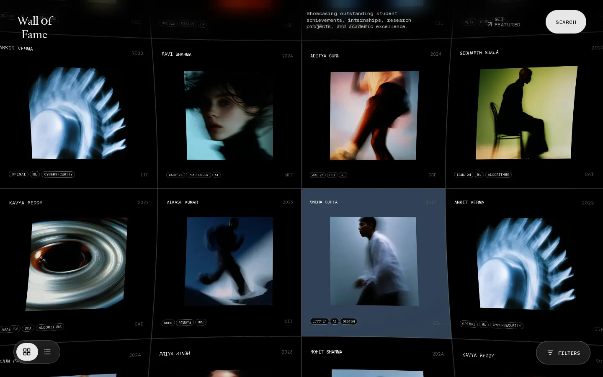
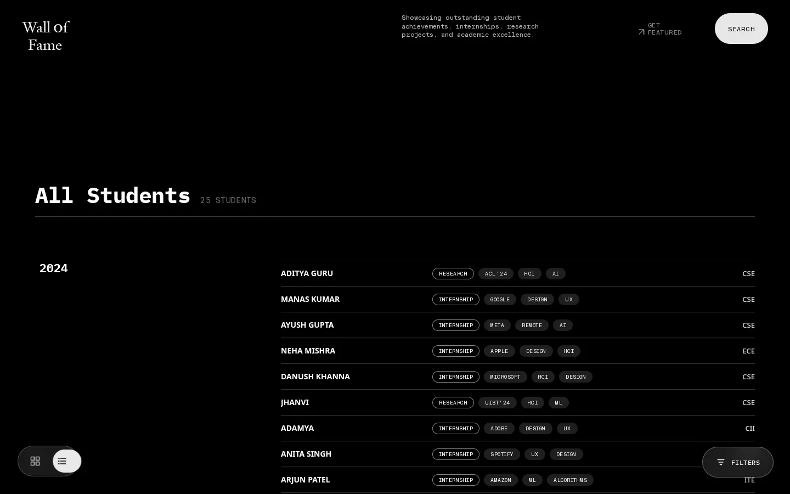

# Getting started

Run Wall of Fame on your machine, then import some students, in about 10
minutes. You don't need a database server: locally the app uses PGlite, a
Postgres that runs inside Node.

- [Prerequisites](#prerequisites)
- [1. Install](#1-install)
- [2. Run it](#2-run-it)
- [3. Tour the wall](#3-tour-the-wall)
- [4. Import students](#4-import-students)
- [5. Run it like production](#5-run-it-like-production)
- [Everyday commands](#everyday-commands)
- [Next steps](#next-steps)

---

## Prerequisites

| Tool | Version | Check |
|---|---|---|
| Node.js | **20.12 or newer** (22 recommended; Render uses 22) | `node -v` |
| npm | comes with Node | `npm -v` |
| Git | any | `git --version` |
| A browser with WebGL | any current Chrome, Firefox, Safari or Edge | – |

## 1. Install

```bash
git clone https://github.com/AyushIsOn/wallOfFame.git
cd wallOfFame
npm install
cp .env.example .env
```

`.env` holds your local settings. The defaults work: `DATABASE_URL` stays empty
(so PGlite is used), and the admin password is `change-me`. Edit
`ADMIN_PASSWORD` if you like. Every setting is explained in
[configuration.md](configuration.md).

## 2. Run it

Use two terminals:

```bash
# Terminal 1: API + database on http://localhost:3000
npm run dev:server
```

```text
[db] seeded 25 sample students
[server] The frontend isn't built yet. Run `npm run build` (then reload), or use `npm run dev` …
Wall of Fame server on :3000
```

The "isn't built yet" line is expected: in development the frontend is served
by Vite, not by this server.

```bash
# Terminal 2: frontend with hot reload on http://localhost:5173
npm run dev
```

Vite opens http://localhost:5173 and forwards `/api` requests to port 3000. Edit
anything in `src/`, `index.html` or `styles.css` and the page updates. After
editing `server/`, restart terminal 1.

On first start the server creates the database in `./.data/pg` and adds 25
sample students (stock photos, made-up names).

## 3. Tour the wall



- **Drag** to pan the infinite grid. Hover a tile to see its colour glow.
- **Click** a tile to open the profile. **Go to next person** steps through the
  students; **Esc** closes.
- **FILTERS** (bottom right) filters by category, department and year.
  **SEARCH** (top right) matches name, department, type and tags.
- The **list icon** (bottom left) switches to the year-grouped list.



## 4. Import students

1. Open http://localhost:5173/admin and sign in with the `ADMIN_PASSWORD` from
   your `.env` (`change-me` unless you changed it).
2. Drag [`docs/examples/import-example.csv`](examples/import-example.csv) from
   this repository onto **Upload sheet**.
3. The status line should read **Imported 3 new, 1 photo saved**.

What the three rows show:

| Student | Demonstrates |
|---|---|
| RIYA DAS | Batch `2022-2026` saved as 2026. The Photo URL `http://localhost:3000/img5.jpeg` is downloaded, resized and stored in the database. This only works while the server runs on port 3000. |
| KABIR SINGH | No photo, so the wall draws an initials card. Tags come from the sheet. Batch `2023-27` → 2027. |
| MEERA IYER | Stipend `Unpaid` shown as text. Tags generated from the About, since the Tags cell is empty. |

Now open the wall and search for "Kabir". Then drop the **same file** again:
the status says **Imported 0 new, updated 3, 1 photo unchanged**, and no
duplicates appear, because every row has a Reg No.

Without n8n, bios are the About trimmed to 256 characters and tags come from a
keyword list. To get real AI bios, see [n8n/README.md](../n8n/README.md).

## 5. Run it like production

One process serves the built site, the admin and the API, exactly as on Render:

```bash
npm run build      # writes dist/
npm start          # http://localhost:3000 and http://localhost:3000/admin
```

## Everyday commands

| Command | What it does |
|---|---|
| `npm run dev:server` | API + database on :3000 (restart after server changes) |
| `npm run dev` | Frontend dev server on :5173 with hot reload |
| `npm run build` | Production build to `dist/` |
| `npm start` | Serve `dist/` + API on `$PORT` (default 3000) |
| `npm run preview` | Serve the built `dist/` with Vite on :4173 (`/api` is proxied to :3000, like `npm run dev`) |
| `npm run thumbs` | Regenerate `public/thumbs/*.webp` after adding sample `public/img*.jpeg` |

| Task | How |
|---|---|
| Reset the local database | Stop the server, delete `.data/pg`, start again (re-seeds the samples) |
| Start empty, without samples | `SEED_SAMPLE_DATA=false` in `.env`, then reset the database |
| Stress-test the wall | Open `/?seed=2000`: 2,000 cloned sample students, no API involved |
| Inspect the renderer | Open `/?debug=1`, then use `window.__wall` in the console (e.g. `__wall.cache.liveTextureCount`) |
| Frontend without the server | Just `npm run dev`: the API calls fail and the dev build falls back to the sample data |

## Next steps

- Deploy it: [deployment.md](deployment.md)
- Understand it: [architecture.md](architecture.md)
- Change it: [recipes.md](recipes.md) and [code-reference.md](code-reference.md)
- Hand it to the admins: [admin-guide.md](admin-guide.md)
