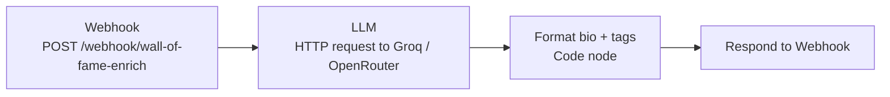

# n8n: AI enrichment (bio + tags)

`enrich.workflow.json` takes a student's raw "About" text and returns a
**polished first-person bio (≤ 256 characters) and 2–3 tags**, using an LLM
through **Groq** or **OpenRouter** (both OpenAI-compatible).



### Contract

| | |
|---|---|
| Request | `POST` JSON `{ "about": "<raw text>" }` |
| Response | `{ "bio": "I …", "tags": ["AI", "ML", "DESIGN"] }` |

The Wall of Fame server calls it:

- for every imported row whose About is new or changed (unchanged rows are
  skipped on re-import),
- when an admin clicks **Generate** next to Tags (`/api/admin/enrich`),
- from `POST /api/admin/students/:id/tags`.

If the webhook isn't configured, fails, or takes longer than **20 seconds**, the
server uses its local fallback (About trimmed to 256 characters, keyword tags),
so imports never fail because of the AI. The server caps the bio at 256
characters and keeps at most 3 tags, uppercased, whatever the workflow returns.

---

## Setup

1. **Import:** n8n → *Workflows* → *Import from File* → `enrich.workflow.json`.

2. **Add your API key:** open the **LLM** node → *Credential* → *Header Auth*,
   and create one with:
   - **Name:** `Authorization`
   - **Value:** `Bearer <your key>`

3. **Pick a provider** (edit the LLM node):

   | Provider | URL | Example model |
   |---|---|---|
   | **Groq** (default) | `https://api.groq.com/openai/v1/chat/completions` | `llama-3.3-70b-versatile` |
   | **OpenRouter** | `https://openrouter.ai/api/v1/chat/completions` | `meta-llama/llama-3.3-70b-instruct` |

   The model name is in the node's **JSON body**. If an OpenRouter model
   rejects `response_format`, delete that line from the JSON body; the Code
   node still parses the reply.

4. **Activate** the workflow, copy the Webhook's **Production URL**
   (`…/webhook/wall-of-fame-enrich`; not the *Test* URL), and set it on the
   server as `N8N_TAGS_WEBHOOK_URL`. On Render: service → *Environment* →
   *Save changes* (the service restarts).

### Test

```bash
curl -X POST "<your-webhook-url>" -H "Content-Type: application/json" \
  -d '{"about":"6 month research internship; published at ACL 2024 on HCI and adaptive AI interfaces."}'
# -> {"bio":"I published at ACL 2024 on human-computer interaction…","tags":["ACL","HCI","AI"]}
```

Then, in the admin, open any student and click **Generate**. LLM-picked tags
mean the connection works; keyword-style tags mean the server fell back
(check the URL and n8n's execution log).

### Tuning

The system prompt, its example, the tone and the 256-character limit live in
the LLM node's JSON body. To change the length limit everywhere, see
[docs/recipes.md](../docs/recipes.md#change-the-ai-prompt-or-bio-length).

### Rate limits

Imports call the webhook once per row, one row at a time. Free LLM tiers are
limited; in 2026 Groq's free tier allows about 30 requests a minute and 1,000 a
day for `llama-3.3-70b-versatile` ([current limits](https://console.groq.com/docs/rate-limits)).
When a limit is hit the call fails and that row gets the local fallback. For
big imports, use smaller batches or a paid tier.

### Privacy

Each About text is sent to the LLM provider. Make sure that provider's
data-use terms fit your institution's policy.

---

## Photos from Google Forms / Microsoft Forms

**n8n is not involved in photos.** The server downloads them from the sheet's
Photo URL column during import, and converts Google Drive and OneDrive share
links to direct downloads. That works when the file is shared **"Anyone with
the link"**; see [docs/admin-guide.md → Photos](../docs/admin-guide.md#photos).

If your organisation can't make files public (locked-down Microsoft 365), one
option is a second n8n workflow that uses n8n's authenticated Google Drive /
OneDrive nodes, signed in as the form owner, to download the files and upload
them through `POST /api/admin/students/:id/image`. It isn't built yet; see the
[roadmap](../docs/roadmap.md).
